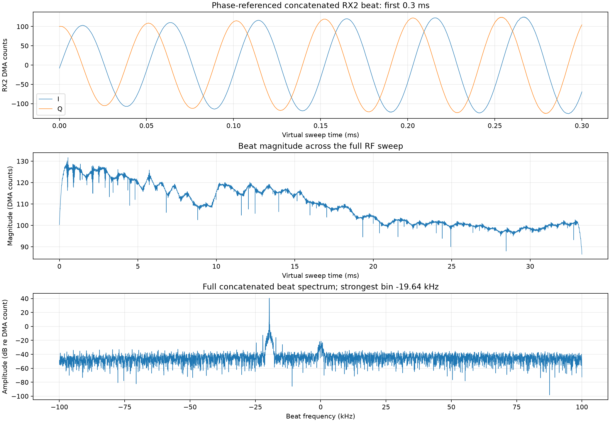
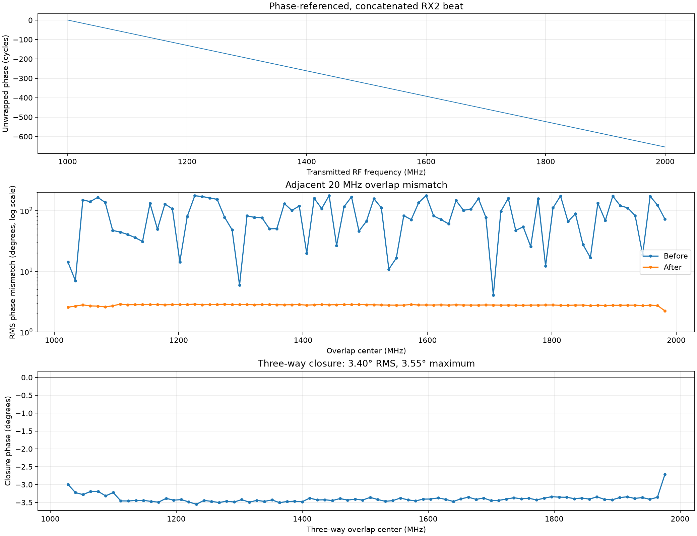

# TX2 FMCW from 1000 to 2000 MHz, with one phase-referenced RX2 beat

The FPGA delays the conjugate of TX2 by 40 radio clocks, then multiplies it
with RX2. RX2 DMA therefore captures complex **beat IQ** after the /8 FIR. The
AD9361 TX filter cannot pass a 1 GHz instantaneous chirp, so
[`tools/fmcw_rx2.py`](../tools/fmcw_rx2.py) uses **82 subchirps** with 20 MHz
overlap: 1000–1032 MHz, 1012–1044 MHz, and so on through 1972–2000 MHz.
The subchirps are 32 MHz wide except the final 28 MHz. TX and RX LOs move
together between subchirps. Each uses a 65,536-sample cyclic TX2 buffer at
61.44 MSPS, repeating every 1.067 ms.

The 40-clock reference delay leaves approximately 4 ns of total delay on the
30 cm, 20 dB attenuated loopback. The active calibration uses a fresh 30 cm
capture and the earlier two-cable coax velocity estimate; a new 5 m capture
is still needed to remeasure that velocity independently.

The phase recovery in [`tools/fmcw_phase.py`](../tools/fmcw_phase.py) folds
eight retained RX2 chirps at each setting, finds their tapered reset, and maps
beat IQ onto the transmitted RF frequency axis. In every 20 MHz overlap it
compares the complex responses at equal RF frequencies. A weighted fit to
their cross-product estimates a phase offset and a differential delay (linear
phase slope). It applies that correction to the next subchirp, then blends
the phase-referenced responses onto one 4 kHz RF grid. This adapts the phase
and delay calibration used across spectral windows in
[radio interferometry](https://science.nrao.edu/facilities/vla/docs/manuals/obsguide/calibration).
The first subchirp defines the arbitrary phase reference. Eight MHz common
to each group of three subchirps supplies a separate closure check.

The resulting `rx2_beat_concatenated.npz` contains one complex beat array,
plus its RF and virtual sweep-time axes. The 33.3 ms time axis uses the first
subchirp's sweep slope. **This is a mathematically stitched beat**, not a
single uninterrupted 1 GHz RF transmission. Phase recovery assumes the
measured scene stays stable while the LOs retune. The beat's phase slope also
includes board latency. A two-cable path calibration is described below.

When path calibration is available, the software applies a zero-phase low-pass
to the virtual beat before plotting and computing the distance FFT. The default
stop range is **100 m**, with a raised-cosine transition from 90 to 100 m to
reduce ringing. The cutoff frequency uses the selected medium's propagation
delay and the calibrated fixed board delay; `--max-range-m` changes the stop
range. `rx2_beat_filtered.npz` contains the processed beat, while
`rx2_beat_concatenated.npz` and the per-segment capture retain the unfiltered
signal. Without path calibration, the script leaves the beat unfiltered because
it cannot convert 100 m to a calibrated beat frequency.

With TX2A connected through at least 20 dB attenuation to RX2A, run a fresh
capture from the repository root:

```sh
.venv/bin/python -m pip install -r tools/fmcw-requirements.txt
./devkit tx-guard affirm 1
.venv/bin/python tools/fmcw_rx2.py \
  --rf-start 1e9 --rf-stop 2e9 \
  --subchirp-span 32e6 --overlap 20e6 \
  --output artifacts/fmcw-rx2-1000-2000-next
```

`--resume` reuses completed checkpoints after an interruption. A fresh run
creates `rx2_interactive.html` alongside the PNGs. Its **Full beat I/Q**
section shows every saved I and Q sample over the complete virtual sweep, and
`rx2_beat_full_signal.png` saves the same full-duration view with raw and
filtered magnitude for comparison when the filter is active.
Open the HTML file in a
browser to zoom, pan, hover over values, and toggle traces; Plotly is embedded
in the file, so it works offline. The dashboard contains the calibrated
distance, concatenated beat, phase recovery, and representative raw subchirps.
The script automatically uses `artifacts/fmcw-rx2-path-calibration.json` when
present. Pass `--calibration <path>` to use a different calibration, or
`--no-calibration` to skip the distance chart.

For a reflected target in air, use `--distance-medium air`. The range axis
subtracts the fixed board delay from the beat delay, then uses the round-trip
path delay `2 × n / c` per metre. The default radio refractive index is
`n = 1.0003`, a near-surface approximation consistent with
[ITU-R P.453](https://www.itu.int/rec/R-REC-P.453-14-201908-I/en). Set
`--air-refractive-index` if local conditions justify a
different value. For example, append these options to a capture or reanalysis
command:

```sh
--distance-medium air --air-refractive-index 1.0003
```

The coax option remains the default and converts delay to one-way cable length.
Air mode reuses only the calibration's fixed TX2/RX2 board delay. A coax loopback
does not by itself calibrate an air-range zero or antenna delays. If no
subchirps match the calibration's RF windows, the dashboard and metadata label
the absolute range unverified because that board delay is extrapolated. The
range resolution is approximately `c / (2 × n × RF bandwidth)` in air;
interpolated FFT display spacing is finer than this physical resolution.

To regenerate the HTML and PNGs from saved IQ without transmitting:

```sh
.venv/bin/python tools/fmcw_rx2.py --reanalyze \
  --output artifacts/fmcw-rx2-1000-2000-after-reboot-20261026 \
  --calibration artifacts/fmcw-rx2-path-calibration.json
xdg-open artifacts/fmcw-rx2-1000-2000-after-reboot-20261026/rx2_interactive.html
```

The script also saves raw captures, per-segment checkpoints, metadata, and
the numerical `rx2_distance_profile.npz`. TX2 is muted and its cyclic buffer
closed after capture.

The live 2026-10-25 loopback run measured:

| Check | Result |
| --- | ---: |
| TX2 subchirp settings | 82 |
| Retained chirps for phase recovery | 8 per setting, 656 total |
| RX2 DMA RMS across settings | 91.4–121.4 counts |
| Adjacent-overlap residual phase | 2.78° RMS mean; 2.88° worst |
| Minimum overlap coherence | 0.99874 |
| Three-way closure across 80 triples | 3.40° RMS; 3.55° maximum |
| Concatenated complex samples | 249,776 |
| Usable RF axis | 1000.480–1999.580 MHz |
| Virtual sweep duration | 33.30 ms |
| Strongest beat bin | −19.64 kHz |





The [run metadata](img/data/fmcw-rx2-1000-2000-20261025/metadata.json),
[concatenated beat IQ](img/data/fmcw-rx2-1000-2000-20261025/rx2_beat_concatenated.npz),
and [representative raw-segment plots](img/data/fmcw-rx2-1000-2000-20261025/rx2_time_frequency.png)
are saved with this page. The full raw captures and all 82 resume checkpoints
remain under `artifacts/fmcw-rx2-1000-2000/` on the measurement host.

## TX2-to-RX2 path delay calibration

On 2026-10-31, the 40-clock elastic delay measured **4.067 ns median total
delay** with the same 30 cm loopback across eight matched RF windows
(3.856–4.254 ns). The measured change from the 16-clock elastic delay was
−390.623 ns; 24 clocks at 61.44 MSPS predict −390.625 ns. The remaining
4.067 ns is about a quarter of one sample clock, so 40 is the nearest
whole-clock setting. The fixed-path term is 2.566 ns after subtracting the
old 5.004 ns/m coax estimate. The current single-cable result is saved in
[`artifacts/fmcw-rx2-path-calibration.json`](../artifacts/fmcw-rx2-path-calibration.json),
with the raw comparison in
[`artifacts/fmcw-rx2-delay40-elastic-vs-delay16.json`](../artifacts/fmcw-rx2-delay40-elastic-vs-delay16.json).

The measurements below describe the earlier bitstream before the reference
delay was added; they establish the coax propagation estimate reused above.

The saved 82-setting capture above used a nominal 30 cm coax loopback. The
30 cm 45-setting capture in the terminal output was overwritten at its shared
output path; this calibration uses the retained 82-setting capture instead.
The second saved capture used a nominal 5 m coax loopback at the same
61.44 MSPS radio rate and /8 RX FIR rate. Its 45 settings used a different
subchirp overlap, so
[`tools/fmcw_path_calibration.py`](../tools/fmcw_path_calibration.py) fits
**eight identical 32 MHz raw subchirps** shared by both runs. It estimates
the phase slope of the 5 m / 30 cm complex beat ratio in each window, then
uses the median added delay. It does not use the rounded spectral-peak labels
or the stitched virtual sweep for this calibration.

| Calibration result | Value |
| --- | ---: |
| Additional cable length | 4.70 m |
| Median added delay across eight matched windows | 23.520 ns |
| Added delay range across those windows | 23.173–24.153 ns |
| Effective coax delay | 5.004 ns/m |
| Effective coax velocity factor | 0.667 |
| Fixed TX2-to-RX2 path delay, median | 653.630 ns |
| Fixed path range across matched windows | 653.479–653.809 ns |

The calibrated relation for a raw subchirp phase-slope delay is approximately
`total_delay_ns = 653.630 + 5.004 * cable_length_m`. This fixed delay includes
the AD9361, FPGA, and interface latency. The length estimate assumes the two
cables have comparable propagation properties and that attenuator placement,
sample rates, firmware, and signal path stay the same. Nominal cable lengths
and the spread across RF windows limit the precision of an inferred length.
The [saved calibration JSON](img/data/fmcw-rx2-1000-2000-20261025/path-calibration.json)
contains all eight matched-window fits.

Recompute the calibration from the saved captures without transmitting:

```sh
.venv/bin/python tools/fmcw_path_calibration.py \
  --short-run artifacts/fmcw-rx2-1000-2000 --short-length-m 0.30 \
  --long-run artifacts/fmcw-rx2-1000-2000-next --long-length-m 5.0 \
  --output artifacts/fmcw-rx2-path-calibration.json
```

Add `--measure-run artifacts/<another-capture>` to estimate a third cable's
length from its matching raw subchirps. The JSON output records the per-window
fits and the median estimate. For reference, the two capture plots show
approximately −19.64 kHz and −20.36 kHz beat peaks; their FFT-bin spacing and
different overlap patterns make those labels less precise than the raw phase
slopes for cable calibration.

After a board reboot on 2026-10-26, a fresh 82-setting capture in
`artifacts/fmcw-rx2-1000-2000-after-reboot-20261026/` measured a −20.33 kHz
peak. Applying the calibration to eight matching raw subchirps estimated
4.991 m for the connected loopback. TX2 was muted after the capture.
The interactive dashboard reports **499.1 cm** from the median raw subchirp
phase fit. The range profile's FFT peak is **497.8 cm** after applying a
1.30 ns phase-slope correction to the stitched virtual beat, using that raw
phase fit as the reference. The 2.4 cm FFT display step is interpolation;
the 1 GHz bandwidth gives approximately **20 cm distance resolution** for
this one-way coax path. The aligned FFT peak is a visualization of the same
measurement, not an independent distance estimate.

To print the key numbers from any run's `metadata.json`:

```sh
jq '{segments:(.segments|length),
     mean_phase_error_deg:([.phase_recovery.pairs[].residual_rms_deg]|add/length),
     worst_phase_error_deg:([.phase_recovery.pairs[].residual_rms_deg]|max),
     closure_max_deg:.phase_recovery.triple_overlap_closure.max_abs_phase_deg,
     beat_hz:.concatenated_beat.strongest_beat_bin_hz}' \
  artifacts/fmcw-rx2-1000-2000-next/metadata.json
```
